# Sezonluk

**Yalnızca dizilere odaklanan, Türkçe dizi takip uygulaması.** İzlediğin dizileri ekle, bölümleri tek dokunuşla işaretle, sıradaki bölümü ve yaklaşan yayınları tek ekranda gör, her bölümden sonra puan ver, tepki bırak, bölümün yıldızını seç ve yorum yaz. Bitirdiğin her sezon ve dizi için o diziye özel rozet kazan, en sevdiklerini profilinde sergile.

Flutter ile Android ve iOS için yazılmıştır; arka uç Supabase, dizi verisi TMDB'dir.

> "Sezonluk" geçici çalışma adıdır. Proje geliştirme aşamasındadır (MVP).

<p align="center">
  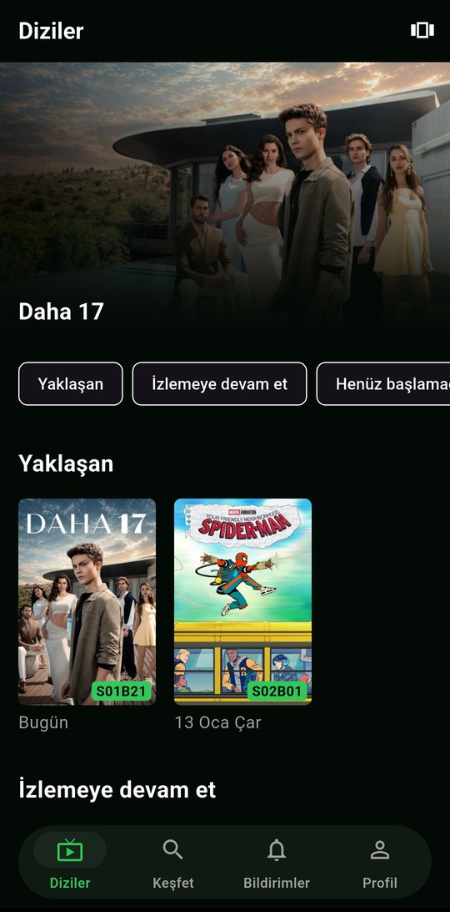
  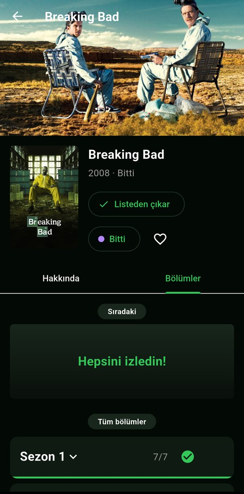
  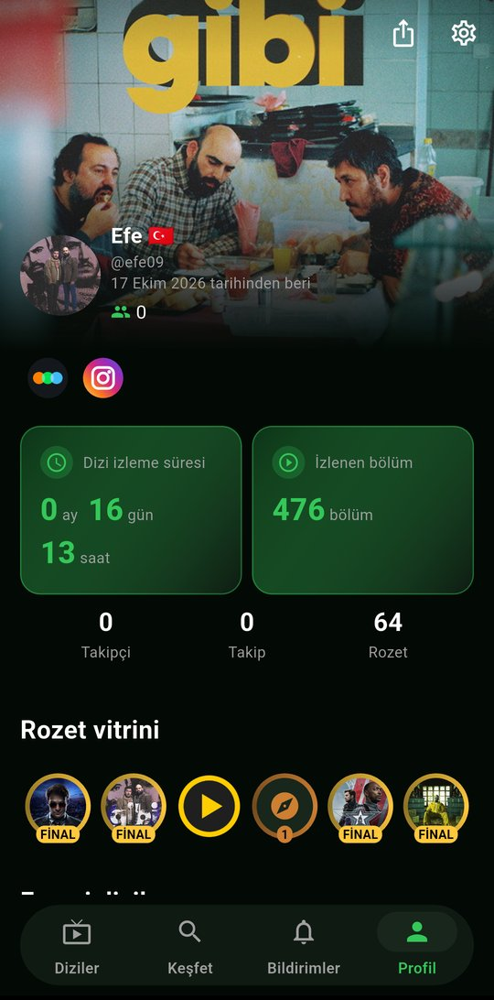
</p>

## Özellikler

### Takip
- **Diziler sekmesi:** Üstte öne çıkan dizi, ardından *Yaklaşan*, *İzlemeye devam et*, *Henüz başlamadıkların*, *Bir süredir izlemediklerin*, *Son izlenen diziler* ve *Arkadaşların ne izliyor* satırları. Liste, ızgara ve afiş görünümü arasında geçiş yapılır.
- **Tek dokunuşla işaretleme:** Afişteki onay düğmesi sıradaki bölümü işaretler. Bir sezonu ya da "buraya kadar" tüm bölümleri tek seferde işaretleyebilirsin. İşaretleme iyimserdir: ekran hemen güncellenir, hata olursa geri alınır.
- **Durum grupları:** Her dizi renkli bir gruptadır: Bitti, Güncel, Devam ediyor, Durduruldu, Dönülmez ve İzleme Listesi. Afişlerin altındaki ilerleme çubuğu grubun renginde dolar.
- **Yaklaşan:** Listendeki dizilerin önümüzdeki 90 gündeki bölümleri, tarihe göre gruplu.
- **Eksik sezonlar kendiliğinden tamamlanır:** Bir sezon bitince sonraki sezonun ilk bölümü "Sıradaki"de görünür.

<p align="center">
  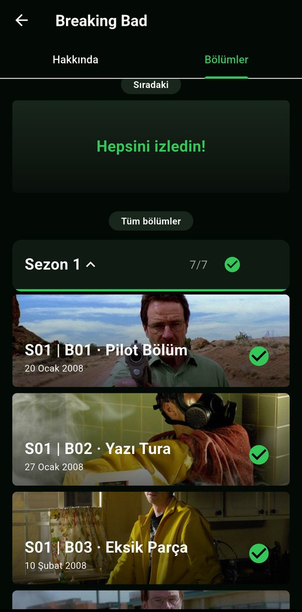
  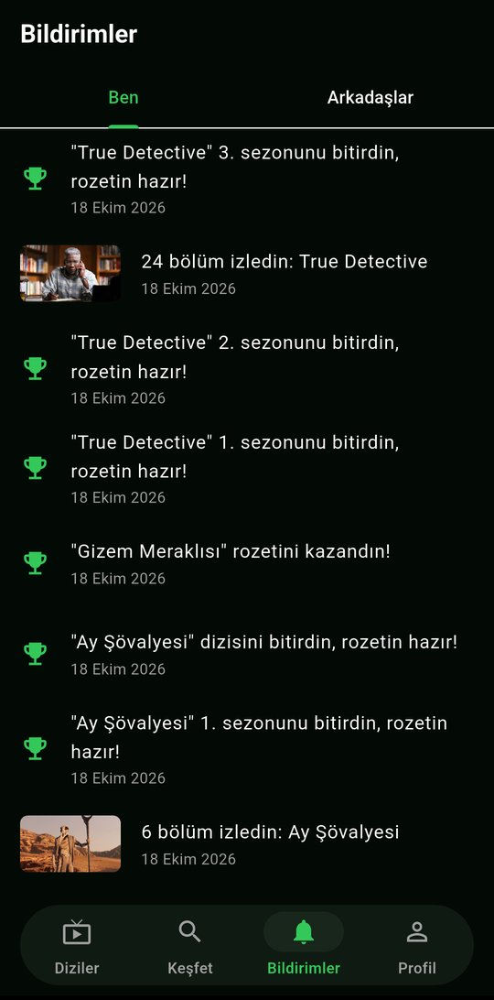
</p>

### Keşif ve öneriler
- **Keşfet:** Şu an yayında olan diziler ve TMDB'de en çok oy almış diziler; aşağı kaydırdıkça yenileri yüklenir. Dizi ve kullanıcı araması ayrı bir sayfadadır.
- **Sana Özel Öneriler:** 16 TMDB türünün yanında Anime, Kore, Türk, Japon, İngiliz ve İspanyol dizileri, Mini diziler, Yeni çıkanlar ve En yüksek puanlılar kategorileri. En fazla 3 kategori seçilir; listende olan diziler önerilmez. "… izlediğin için" bölümü son izlediğin diziye benzer dizileri gösterir.

<p align="center">
  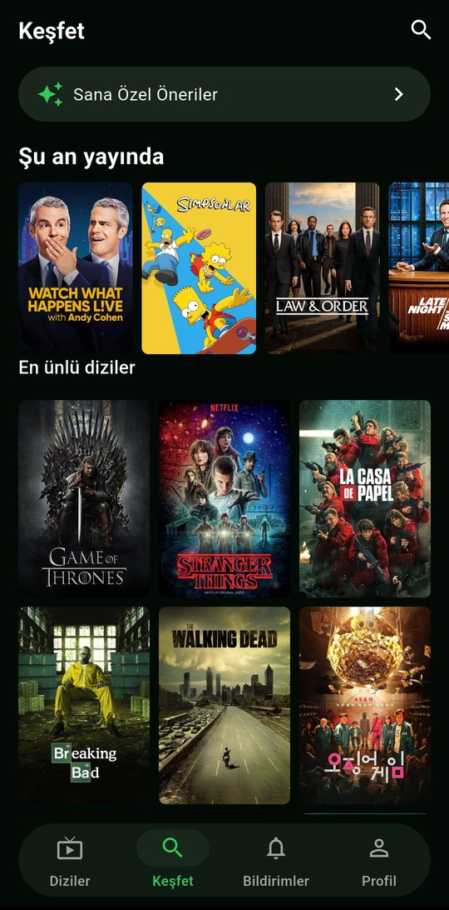
  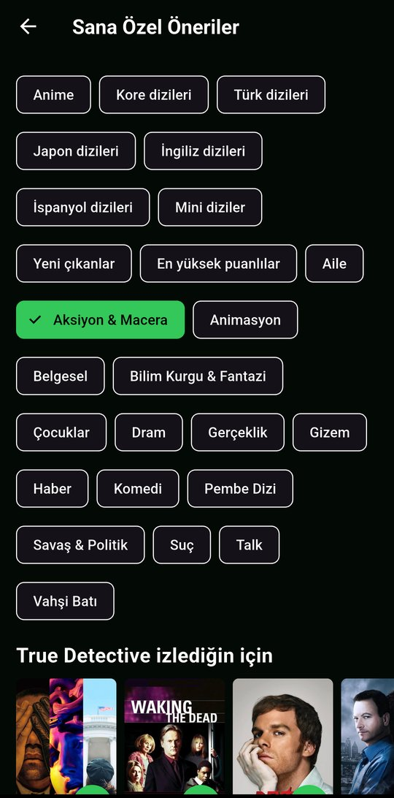
</p>

### Bölüm sonrası
- 5 yıldız üzerinden yarım adımlı **puan** ve **beğeni**.
- 12 duygu arasından **tepki**; tepki verdikten sonra herkesin tepkilerinin yüzdesi görünür.
- Bölümün oyuncularından **bölümün yıldızı** oylaması.
- **Yorumlar ve spoiler koruması:** İzlemediğin bölümün yorumları gizli başlar; spoiler işaretli yorumlar bulanık görünür.

<p align="center">
  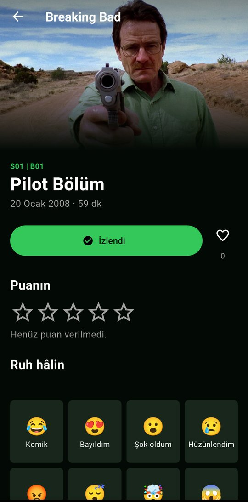
  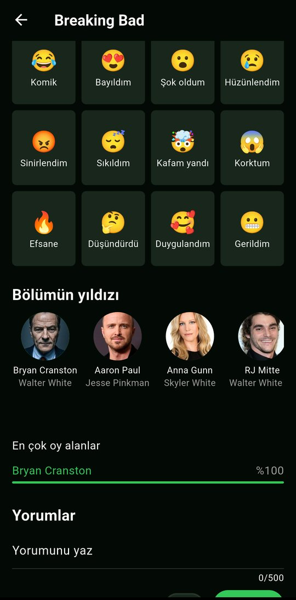
</p>

### Profil ve rozetler
- **Profil:** Seçtiğin bir dizinin arka planından kapak, avatar, Letterboxd ve Instagram bağlantıları, renk paletine göre değişen istatistik kartları (izleme süresi, izlenen bölüm), favori diziler, şu an izlediklerin, son etkinlik, puan dağılımı grafiği ve tüm dizilerin.
- **Dizi ve sezon rozetleri:** Her sezonu bitirince o sezonun afişinden yapılmış gümüş madalyon, bitmiş bir diziyi tamamlayınca altın "FİNAL" madalyonu.
- **Tür rozetleri:** 16 tür × 3 kademe (o türde bitmiş 1, 5 ve 10 dizi), türe uygun simgeler ve bronz, gümüş, altın halkalar. Bunlara bölüm sayısı, dizi sayısı ve yorum rozetleri eklenir.
- **Rozet vitrini:** Kazandığın rozetlerden en fazla 6'sını seçip profilinde sergilersin.

<p align="center">
  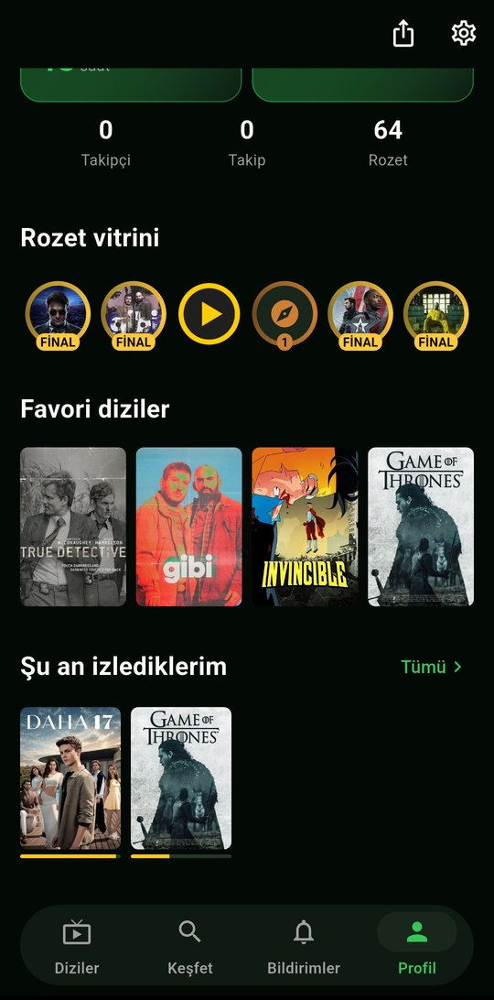
  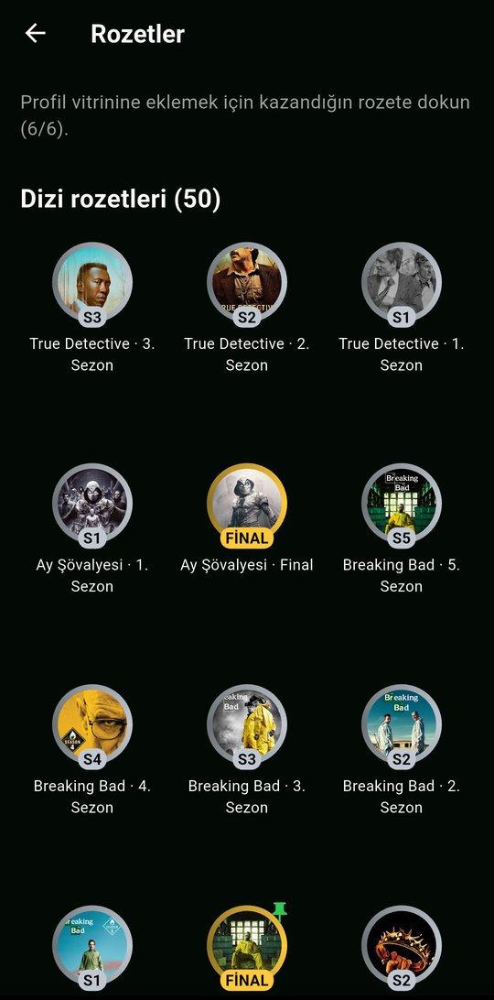
  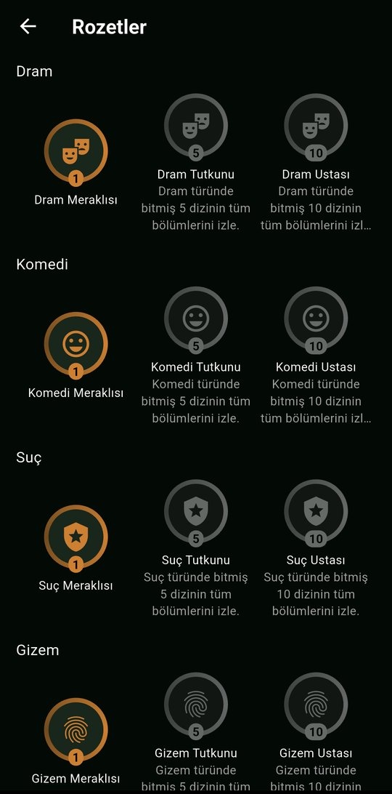
</p>

### Sosyal
- Takip etme ve takipçi listeleri; tüm profiller herkese açıktır.
- **Bildirimler › Ben:** Yeni takipçi, beğenilen yorum, kazanılan rozetler ve kendi izlemelerin.
- **Bildirimler › Arkadaşlar:** Takip ettiklerinin izlemeleri, puanları ve rozetleri.
- Şikayet etme, engelleme ve yasaklı kelime filtresiyle moderasyon.

### Diğer
- **Misafir modu:** Hesap açmadan Keşfet, öneriler ve dizi detayları gezilebilir.
- **Görünüm:** 6 koyu renk paleti, Türkçe/İngilizce arayüz, palet renklerinde 6 alternatif uygulama simgesi.
- **Animasyonlar:** Listelerin sırayla girişi, afişten dizi detayına geçiş, dolan ilerleme çubukları ve sayarak gelen istatistikler. Sistemde "animasyonları azalt" açıksa hepsi kapanır.

## Teknoloji

| Katman | Kullanılan |
|---|---|
| İstemci | Flutter (stable) + Dart 3, yalnızca Android ve iOS |
| Durum yönetimi | `flutter_riverpod` (kod üretimi yok) |
| Gezinme | `go_router` |
| Arka uç | Supabase: Auth, Postgres (RLS, tetikleyiciler, RPC), Storage, Edge Functions (Deno/TypeScript), pg_cron |
| Dizi verisi | TMDB API v3, yalnızca `supabase/functions/tmdb-proxy` üzerinden (API anahtarı istemcide yoktur) |
| Test | `flutter test` (birim ve widget), pgTAP (veritabanı), Maestro (uçtan uca) |

İş kurallarının çoğu Postgres içindedir: rozetler ve bildirimler tetikleyicilerle verilir, sıradaki bölüm, ilerleme ve istatistikler SQL fonksiyonlarıyla hesaplanır, her tablo satır düzeyinde güvenlikle (RLS) korunur.

```
[Flutter uygulaması] ──supabase_flutter──► [Supabase]
                                             ├─ Auth (e-posta + şifre, anonim misafir)
                                             ├─ Postgres (tablolar + RLS + tetikleyiciler + RPC)
                                             ├─ Storage (avatarlar)
                                             └─ Edge Functions
                                                  ├─ tmdb-proxy ──► TMDB API
                                                  ├─ tmdb-sync (günlük)
                                                  └─ delete-account
```

## Klasör yapısı

```
lib/
  app/          rotalar, alt menü kabuğu, açılış animasyonu
  features/     özellik başına: data/ (repository, modeller), logic.dart, providers.dart, screens/, widgets/
  shared/       ortak widget'lar (afiş, ilerleme çubuğu, animasyon parçaları…)
  core/         yapılandırma, TMDB görsel adresleri, biçimlendirme, hata türleri
  theme/        renkler, paletler, boşluklar, yazı stilleri
  l10n/         Türkçe ve İngilizce arayüz metinleri
supabase/
  migrations/   veritabanı şeması
  functions/    tmdb-proxy, tmdb-sync, delete-account
  tests/        pgTAP testleri
test/           lib/ yapısını aynalayan birim ve widget testleri
docs/           gizlilik politikası, kullanım şartları, ekran görüntüleri
```

## Kurulum

Gerekenler: Flutter SDK (stable), Android Studio ve bir Android emülatörü ya da cihaz, Supabase CLI.

1. Bağımlılıkları kur:
   ```bash
   flutter pub get
   ```
2. `env/example.json` dosyasını `env/dev.json` olarak kopyala ve Supabase projenin adresini ve anon anahtarını yaz. Bu dosya depoya eklenmez. Buraya asla gizli anahtar konmaz; TMDB anahtarı yalnızca Edge Function sırrıdır (`supabase secrets set TMDB_API_KEY=…`).
3. Veritabanı şemasını ve fonksiyonları Supabase projene yükle:
   ```bash
   supabase link --project-ref <proje-ref>
   supabase db push
   supabase functions deploy tmdb-proxy
   ```
4. Uygulamayı çalıştır:
   ```bash
   flutter run --dart-define-from-file=env/dev.json
   ```

## Komutlar

| Amaç | Komut |
|---|---|
| Tüm doğrulama (analiz → biçim → testler) | `dart run tool/verify.dart` |
| Birim ve widget testleri | `flutter test` |
| Veritabanı testleri | `supabase test db --linked` |
| Performans ölçümü | `flutter run --profile --dart-define-from-file=env/dev.json` |
| Android sürüm derlemesi | `flutter build appbundle --release --dart-define-from-file=env/prod.json` |

Proje kuralları ve kapsam için [CLAUDE.md](CLAUDE.md), [ISKELET.md](ISKELET.md) ve [AGENT.md](AGENT.md) dosyalarına bakın.

## Yasal

- [Gizlilik Politikası](docs/privacy.md) · [Kullanım Şartları](docs/terms.md)
- Uygulamada üçüncü taraf analiz, reklam veya izleme SDK'sı yoktur.

<p>
  
</p>

Bu ürün TMDB API'sini kullanır ancak TMDB tarafından onaylanmamış veya sertifikalandırılmamıştır. Dizi bilgileri ve görselleri [The Movie Database (TMDB)](https://www.themoviedb.org/) kaynaklıdır.
